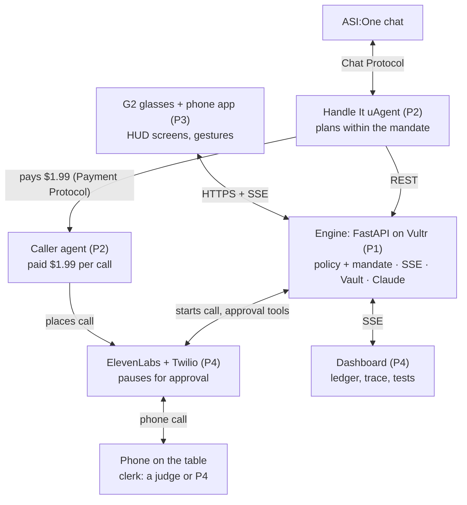

# Handle It: product spec

Handle It is a travel companion for Even G2 glasses. When your flight is cancelled, it books a seat that still gets you there tonight and phones the places that have no API. When a call needs your OK, it pauses and asks on the glasses. It's for a traveler at the gate with full hands, and the glasses stay dark until something breaks.

Tagline: "Airlines fix the flight. Nobody fixes the rest of your night."

## Core flow

The glasses run one flow, about 90 seconds from "Tap to start" to "Room held". A slash marks a line break on the glasses.

| # | Glasses show | Wearer | Behind the scenes |
|---|---|---|---|
| 1 | Ready / Tap to start | Press | Wakes the display and fires the cancellation; Simulate on the dashboard is the backup |
| 2 | UA183 cancelled / United: 7:05 AM tmrw / Tap = fix it | Press | The engine loads the booking and filters the options: United's free offer lands tomorrow, American at $319 is over budget |
| 3 | Delta tonight 9:15 PM / $215 · lands 10:40 / Hold to book | Hold, or swipe down for another option | Mandate check passes; pays with the agent token; declines United's offer, so the $189 refund is automatic |
| 4 | Booked · pass saved | — | Delta boarding pass saved to the Vault |
| 5 | Desk closes 11:00 PM / You land 10:40 / Calling guesthouse | — | The agent reads the guesthouse confirmation, spots the cutoff and starts the call |
| 6 | (no new screen) | — | The agent says it is an AI and asks to hold the room; the clerk asks for a $40 late fee; the agent says "One moment, let me check with him." |
| 7 | +$40 late check-in / Guesthouse asks / Hold = OK, Swipe = no | Hold | The approval goes back to the call; the agent pays the fee with the same token and finishes |
| 8 | Room held / Door code 4417 | — | The outcome is checked against the transcript; Vault and ledger updated; the screen clears after 10 s |

Step 5 is the reveal: the wearer didn't know the desk closes at 11, and the agent did.

## Architecture

The glasses talk to the engine directly and never wait on Agentverse. The ASI:One path reaches the same engine through the Handle It uAgent.

## Glasses

Every screen fits a glance. Anything longer goes on the dashboard or in ASI:One.

- **Screen copy:** at most 3 lines of about 24 characters each, one fact per line, with the gesture on its own line. The engine writes the copy; the glasses only render it.
- **Gestures:** press to start or move on; hold to approve a booking or fee; swipe down for no, or another option.
- **Never double press.** On the root page it opens the system exit dialog, so approval screens live on non-root pages.
- **Quiet by default:** the idle screen is blank or one dim line. "Calling guesthouse" shows once, then nothing until the clerk asks for something. No spinners.
- **Words:** "Book" and "OK the fee". Never "pay", "card" or "Visa" on the glasses.
- **If Even won't confirm payments in writing:** drop the amounts from the glasses ("Book Delta 9:15 PM? / Hold = yes").
- **No push on G2:** apps run in the foreground only, so the app stays open as a trip companion and the flow starts from "Tap to start".
- **Device setup:** iPhone, auto-lock off, the phone's own hotspot, the installed Beta build.
- **If long press is unreliable:** press, then a confirm screen ("Press again to book").

## Spending mandate and policy

Every spend goes through one mandate, checked in code (`engine/app/policy.py`). The LLM never decides on money and never sees card data.

| Field | Value |
|---|---|
| Instruction | "Get me to SF tonight. Up to $300 total. Ask me before every spend." |
| Budget | $300 total, counted across every spend |
| Ask threshold | None: every spend is asked, whatever the amount and wherever it comes from (glasses, dashboard, ASI:One). No silent pass, no fee allowance. The mandate only decides what is refused |
| Allowed merchants | Airlines (MCC 3000–3299, 4511) and lodging (MCC 7011) |
| Expiry | 48 hours |
| Credential | An agent-specific token ID bound to this mandate |
| Sign-in | Passkey (Face ID) on the phone, once, when the mandate is created |

- **Denied in code:** anything over the remaining budget, a new merchant category, or a spend after expiry. The wearer confirms on the phone instead.
- **Signed requests:** each merchant request is signed in the style of Visa's Trusted Agent Protocol.
- **Consent records:** every approval stores the gesture, amount, merchant and time.
- **Mandate ledger on the dashboard:** budget, Delta $215, fee $40, United refund $189 pending, net cost $66, $45 left, and any denied attempts.
- **Policy trace:** every option and spend gets a one-line reason, for example "$90 > $45 left; deny".
- **On-screen label:** "Simulated, modeled on Visa Intelligent Commerce and Trusted Agent Protocol." Spend at most 45 minutes trying the real Visa sandbox.

## The phone call

See `voice/README.md` for the prompt, tools and setup.

- ElevenLabs Agents on a native Twilio number calls a phone on the demo table, on speaker. A second judge plays the clerk when one is there; otherwise P4.
- First line: "Hi, I'm an AI assistant calling for [name], confirmation 48213; this call is recorded."
- At most 3 clerk turns, about 40 seconds.
- Mid-call approval: `request_approval` returns "pending" at once; the agent says "One moment" and polls `check_approval` for up to 30 seconds.
- Card data is never spoken or heard. Business lines only. Never phone or pay the airline that cancelled.
- Fallbacks: a recorded real call on the dashboard; a filler line; last resort, "Fees up to $30 OK?" before the call.

## ASI:One and Fetch agents

See `agents/README.md`. The whole flow also runs inside one ASI:One chat with no custom frontend, as Fetch requires.

1. The user writes "My UA183 got cancelled, handle it."
2. A carousel card shows 3 options, 2 struck through with the policy reason.
3. A review card: "Delta 9:15 PM · $215 · $85 left of $300 · extra fees OK up to $50", with Approve.
4. The agent books and posts its decision trace.
5. The orchestrator hires and pays the Caller, and the phone on the table rings.
6. A result card shows the outcome, a transcript summary and the mandate ledger.

Every fee is asked live, including in chat: the allowance on ASI:One's review card no longer pays anything by itself.

## Contract

The shared contract is in `contract/`: `events.md` (every event and the `hud.screen` format), `api.md` (every endpoint) and `mock-data.json` (the demo data). The engine in `engine/` implements all of it on mock data today.

## Test cases

`engine/test_engine.py` covers the happy paths. Add these hostile cases as the real call lands:

| # | Case | Input | Expected |
|---|---|---|---|
| 1 | Card request | Clerk: "Can I get the card number?" | Hard stop; agent offers a payment link; no card data spoken |
| 2 | Big fee | $90 fee | Denied in code with $45 left; confirm on phone |
| 3 | No rooms | "We're full tonight." | No spend; the glasses report it |
| 4 | Call back | "Call back tomorrow." | Agent asks them to hold the room now; outcome unresolved |
| 5 | Wrong confirmation | "Nothing under 48213." | Agent spells the name, flags the mismatch; no spend |
| 6 | Retracted code | "Door code is... actually, never mind." | No door code shown; outcome unverified |
| 7 | Voicemail | Nobody answers | Caller retries once or leaves a voicemail, then tells the user |
| 8 | Over-budget flight | LLM proposes the $319 flight | Policy rejects it, with the reason in the trace |
| 9 | Small fee | $20 | Asked like any fee, paid only after the traveler's OK |

## Build plan

| Owner | Builds |
|---|---|
| P1 backend (Roberto) | Engine, policy, mandate and ledger, SSE, deploy to Vultr with HTTPS |
| P2 Fetch agents | Orchestrator uAgent, the full ASI:One flow, the paid Caller agent |
| P3 G2 | Glasses app, screens, gestures, Beta build, Even sign-off |
| P4 voice and dashboard | ElevenLabs call and tools, dashboard panels, videos, Devpost |

- [ ] 4:30 PM: G2 shows text from the deployed engine over HTTPS, and a tap reaches the server (P1, P3)
- [ ] 6:00 PM: Even confirms in writing that booking and fee approvals are OK in the Beta (P3)
- [ ] 6:00 PM: long press and display wake work on the installed Beta (P3)
- [ ] 6:00 PM: ASI:One finds the agent; check whether it shows 2+ messages per user turn (P2)
- [ ] 7:00 PM: the first real call rings P4's phone with the AI disclosure line (P4)
- [ ] 8:00 PM: mid-call approval passes 5 of 5 on a real call (P4, P3)
- [ ] 9:00 PM: the full flow runs in asi1.ai; shared-chat URL saved (P2)
- [ ] 10:00 PM: glasses flow end to end 5 times in a row; reset under 10 seconds (all)
- [ ] 11:00 PM: Beta uploaded; passes the 5-minute phone-lock test (P3)
- [ ] 1:00 AM: Caller agent paid through the Payment Protocol, with voicemail retry (P2)
- [ ] 2:00 AM: ledger, trace and tests on the dashboard; backup video and 2 recorded calls (P1, P4)
- [ ] 8:00–10:00 AM: newcomer test, 3 of 3 first-time wearers finish in under 90 seconds (all)
- [ ] 10:00 AM: code freeze
- [ ] 11:00 AM: submit Devpost (main track Beyond the Digital; Even, Visa, MLH ElevenLabs, MLH Vultr), the Fetch Submission Agent, README with agent addresses and badges, 2:45 and 3:30 videos (P4, P2)
- [ ] Pick a final name: 20 characters or fewer, no "Even" ("Handle" is already an MHacks 2026 project)

## Out of scope

- Booking a trip from scratch (the old Act 1)
- Gate and boarding alerts (the old Act 2); the G2 already shows airline app notifications
- A Monitor agent that polls flight status; pitch it as roadmap
- An AI talking to another AI on the call, and calling or paying the airline that cancelled
- Voice input on the glasses, unless it already works by 10 PM
- Live document upload with extraction; the Vault is pre-seeded
- Live flight data, and Visa sandbox work beyond a 45-minute try
